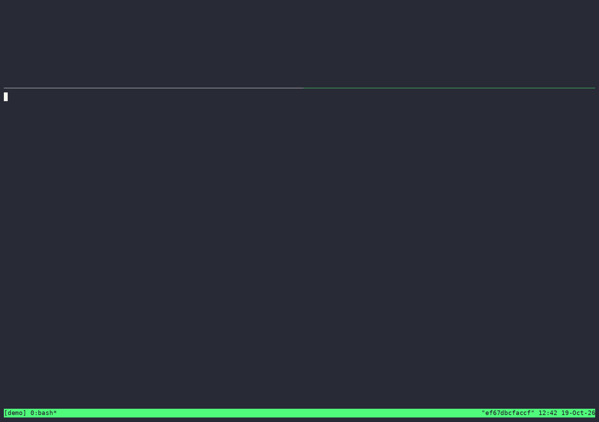

# qwen-vl-inference-arena

Capstone submission for the Vizuara Inference Engineering workshop (InferTutor Arena).

My implementation of the Vizuara Inference Engineering capstone:
serve `Qwen/Qwen3-VL-4B-Instruct` with vLLM, load test it, tune it, report it.
The tooling supports Modal and rented GPUs; the submitted runs used 1× H100 SXM on RunPod.

## Result

**Score 4,680,469,940 on 1× H100**, mixed track, 300 users, 0 errors
(TTFT p95 123 ms, ITL p95 8.5 ms, 16,375 chunks/s). The default config scored 6.6M on the same setup.

| Config | Score | Next wall found |
|---|---:|---|
| Default (seq32, 50 users) | 6.6M | requests queue behind 32 seats |
| `max_num_seqs` 256, 300 users | 0.6–0.8B | `VLLM::EngineCore` pinned at 100% CPU (eager kernel launches) |
| + CUDA graphs (compiled mode) | 0.53B | the single API server pinned at 100% CPU |
| + `--api-server-count 2` | **4.68B** | the load generator itself (~99% CPU) |



The final run as a video: [`media/demo.mp4`](media/demo.mp4). Illustrated 9-page report:
[`docs/report/InferTutor_Arena_Himanshu_Prajapati.pdf`](docs/report/InferTutor_Arena_Himanshu_Prajapati.pdf).

21 runs in about 80 minutes for about $5.50. Details: `REPORT.md` (one page) and
`EXPERIMENTS.md` (every run, with the hypothesis written before it). The load tester ran on the
GPU box, so TTFT has no internet RTT and the score is not comparable to the Modal reference.

## Contents

- `PLAN.md` — the engineering plan, hypotheses, experiment matrix, budget.
- `REPORT.md` — the one-page engineering report (method written, numbers filled after the runs).
- `EXPERIMENTS.md` — per-run log with hypotheses written before each run.
- `docs/knob_notes.md` — why each serving knob moves which metric.
- `tools/runpod_serve.sh` — launch vLLM with identical flags on a rented non-Modal GPU.
- `tools/runpod_matrix.sh` — run the experiment matrix on the GPU box itself (restarts vLLM only when server knobs change).
- `tools/runpod_record.sh` — record one run as a terminal video (live GPU stats + load test) to GIF/MP4.
- `tools/make_submission.py` — copies the best run and reconstructs the exact command into `submission/`.
- `tools/stop_all_apps.sh` — stops every Modal app from this project.
- `starter_code/` — official starter kit. One addition: the runner stamps the serving knobs into each result JSON (`config.serving`) so experiments are self-describing. Scorer and prompts are untouched.
- `tools/run_matrix.sh` — runs the required experiment matrix and stops each Modal app afterwards.
- `tools/results_table.py` — renders all result JSONs as a Markdown table with scores.
- `tools/mock_vllm_server.py` — local OpenAI-compatible mock so the harness can be tested without a GPU.
- `docs/` — the assignment and Modal runbook Markdown sources.
- `submission/` — final JSON and the exact final commands (`final_command.sh` is written by hand for the RunPod run, because `--api-server-count` is not a runner flag).

## Setup

```bash
uv venv --python 3.12
uv pip install -r starter_code/requirements.txt
source .venv/bin/activate
modal token new
modal secret create huggingface HF_TOKEN=<your_hf_token>
```

## Local dry run (no GPU)

```bash
python tools/mock_vllm_server.py --port 8000 &
python starter_code/load_test_infertutor.py --url http://127.0.0.1:8000 --mode mixed --users 20 --duration 20 --ramp-up 5 --label mock
python tools/results_table.py
```

## Real runs

```bash
cd starter_code
python run_infertutor_experiment.py --label smoke --gpu-type H100 --replicas 1 --mode text --users 5 --duration 30 --ramp-up 5 --max-tokens 64
modal app stop infertutor-smoke
cd ..
tools/run_matrix.sh                 # full matrix
tools/run_matrix.sh m-base-100u     # one experiment
python tools/results_table.py --sort score
```

## Renting a GPU elsewhere (RunPod, Lambda, etc.)

This is how the submitted runs were made: 1× H100 SXM, RunPod PyTorch template, 80 GB
container disk, no volume. Everything runs on the box inside `tmux`, and the load tester hits
`127.0.0.1`, so results do not depend on your internet connection.

```bash
cd /root && git clone https://github.com/himanshu1573/qwen-vl-inference-arena.git && cd qwen-vl-inference-arena
curl -LsSf https://astral.sh/uv/install.sh | sh && source $HOME/.local/bin/env
uv venv --python 3.12 && source .venv/bin/activate
uv pip install "vllm==0.21.0" "qwen-vl-utils==0.0.14" -r starter_code/requirements.txt
# The RunPod template enables hf_transfer for its own Python; the venv lacks it and the
# model download fails with "Can't load the configuration of 'Qwen/...'".
export HF_HUB_ENABLE_HF_TRANSFER=0 HF_HOME=/root/.cache/huggingface

tools/runpod_matrix.sh m-base-50u m-base-100u m-base-150u     # user sweep on the default config
tools/runpod_matrix.sh m-s128-100u m-s256-300u                # any m-s<seqs>-<users>u point
BASE_SEQS=256 KNEE_USERS=300 tools/runpod_matrix.sh m-compiled-api2 m-nopc m-nocp
submission/final_command.sh                                   # the submitted final run
```

Label suffixes: `-api<N>` adds N API server processes, `-r<N>` repeats a run under its own label.

To run the server and runner separately, the starter runner can benchmark any OpenAI-compatible
endpoint via `--url`. Start the server with the same flags the Modal app uses:

```bash
MAX_NUM_SEQS=32 MAX_NUM_BATCHED_TOKENS=4096 tools/runpod_serve.sh
```

From your laptop, point the runner at it and pass the same knobs so they are stamped into the result:

```bash
cd starter_code
python run_infertutor_experiment.py --url http://<box-ip>:8000 --label m-base-100u \
  --replicas 1 --max-seqs 32 --max-batch-tokens 4096 --mode mixed --users 100 --duration 90 --ramp-up 20 --max-tokens 96
```

## Wrapping up

```bash
python tools/make_submission.py            # copies best mixed run + exact command into submission/
tools/stop_all_apps.sh                     # stop every infertutor-* Modal app
pytest -q                                  # tests for the local tooling
```
